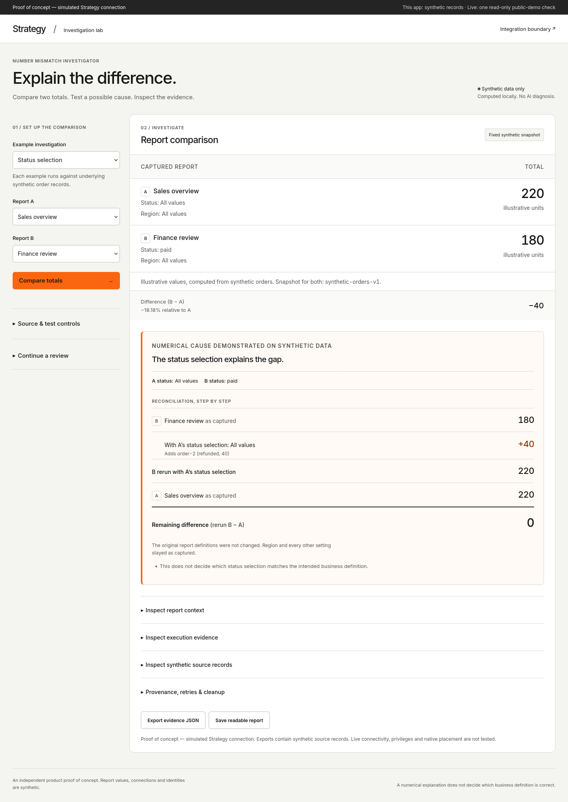

# Strategy mismatch investigator: explains a gap between two report totals on synthetic data

[](https://github.com/RahilBhavan/strategy-mismatch-investigator/actions/workflows/ci.yml)
[](LICENSE)



This is a proof of concept. It compares two reports built on the same synthetic order records and tests whether one changed selection explains the difference between their totals. It shows the measured impact and the remaining difference, with the evidence behind them. **The app uses synthetic records and a simulated Strategy adapter. A separate script ran the same method once, read-only, against Strategy's public demo server. No customer's Strategy deployment is tested.** It is independent work by Rahil Bhavan, not affiliated with, endorsed by or an official product of Strategy (formerly MicroStrategy).

## What it does

- Compares two totals and states the difference. In the default example, A is 220 and B is 180 (illustrative units, not money).
- Reruns B with a transient change to one selection. Changing B's status selection to match A gives B = 220, a measured impact of 40 and a remaining difference of 0. The original report definitions are not changed.
- Abstains instead of inventing a cause when the evidence does not support one: different snapshots, two selections that differ, missing unit context or no known amounts.
- Exports the evidence as JSON or a readable HTML report. Reopening a JSON packet validates its source and recomputes the arithmetic. Altered packets are rejected.
- A numerical explanation does not decide which business definition is correct. The interface says so.

## How it works

- `app/schema.py` validates input and builds exact decimal quantities and content fingerprints.
- `app/adapter.py` computes the synthetic reports, with retry, cancellation and instance accounting.
- `app/investigate.py` runs the deterministic comparison and the controlled experiment.
- `app/store.py` persists cases and jobs in local SQLite and reopens validated evidence.
- `app/server.py` is the local HTTP boundary and serves `web/`.
- `app/live.py` is a read-only client for Strategy's public demo server. The app does not use it.

There is no LLM, paid API or hosted font. The app sends nothing off the machine; only the optional live check below contacts a server.

## Run it

Prerequisite: Python 3.11 or later. The application has no third-party dependencies. CI uses Python 3.12. The tests were last run on Python 3.14.

```bash
git clone https://github.com/RahilBhavan/strategy-mismatch-investigator
cd strategy-mismatch-investigator
python -m unittest discover -s tests -v
python -m app.server --port 8807
```

Observed on 2026-10-25: 33 tests pass. Open http://127.0.0.1:8807 once the server runs.

1. Choose the Status selection example and click **Compare totals**: A is 220, B is 180.
2. Click **Test the status selection**: B becomes 220, the measured impact is 40 and the remaining difference is 0.
3. Open the context, execution and source-record panels.
4. Change the refunded amount under Source & test controls and rerun. The evidence changes with the data.
5. Try Different snapshots or Two selections differ. The tool abstains.
6. Export JSON or the readable report. Reloading a saved `?case=...&job=...` URL reopens the persisted evidence.

The default database is `.local/demo.sqlite3`, ignored by Git. Use `--db /path/to/scratch.sqlite3` for an isolated instance. The server binds to 127.0.0.1; `--host` exists only for checking on your own devices over a private network. A separate `--db` restores the pristine examples without deleting existing evidence.

The tests call the public computation and HTTP interfaces. They cover cancellation, stale input, exact decimal arithmetic, boundaries, restart and tampered packets.

## Live read-only check

```bash
python -m app.live > verification/live-demo-check.json
```

This signs in to Strategy's public demo server as a guest and repeats the investigation on two real Tutorial reports. On 2026-10-24, report A (Region Category) totalled 35,023,708.15 and report B (Electronics Revenue by Region) 21,666,380.90. Rerunning A with Category = Electronics left 2,724,921.95. Also excluding the Web region left 0.00, which exposed an exclusion that B's name does not mention. The guest may not read B's filter, so this is a numerical reproduction, not a reading of B's definition. It changes no saved objects and logs out. See `docs/ADAPTER.md`.

## Browser checks

The scripts in `verification/` drive the app with Playwright. Each starts its own server and throwaway database. Playwright is a verification dependency, not a runtime one.

```bash
uv run --no-project --with playwright python verification/browser_check.py   # also keyboard_check, layout_checks,
                                                                            # contrast_audit, assistive_check
verification/run_matrix.sh   # Chromium and WebKit in Microsoft's Playwright image; needs podman
```

`assistive_check.py` runs axe-core's WCAG 2.2 AA rules in five states, saves the accessibility tree and checks touch targets on emulated iPhone 15 and Pixel 7 plus Chromium's emulated forced colours. The same checks were run with WebKit on macOS 27.2. [`docs/MANUAL-CHECKS.md`](docs/MANUAL-CHECKS.md) lists what still needs a person: real Safari, VoiceOver, a phone, Windows High Contrast and a session with a Strategy user.

## Repository layout

- `app/`: the Python application.
- `web/`: the comparison interface, evidence export, contract page and the bundled Inter font.
- `tests/`: the unit and HTTP tests.
- `docs/`: the spec, the adapter contract and the acceptance criteria.
- `verification/`: the acceptance receipt, independent review rounds, browser check scripts, their receipts and screenshots.
- `explore/`: three saved design studies. They are not implemented features.
- `DIRECTION.md`: the design direction.

## Documentation

- [`docs/SPEC.md`](docs/SPEC.md): scope, non-goals and the plan.
- [`docs/ADAPTER.md`](docs/ADAPTER.md): which contract fields are inspired by Strategy's public REST documentation and which are designed locally.
- [`docs/ACCEPTANCE.md`](docs/ACCEPTANCE.md): the acceptance criteria.
- [`verification/ACCEPTANCE-RECEIPT.md`](verification/ACCEPTANCE-RECEIPT.md): the evidence for each criterion.
- [`verification/REVIEW-R6.md`](verification/REVIEW-R6.md): the latest independent design critique.
- [`docs/MANUAL-CHECKS.md`](docs/MANUAL-CHECKS.md): checks that need a person.

## Scope and limits

- The app runs on synthetic records and a simulated adapter. One read-only check ran against Strategy's public demo; customer deployments, privileges, prompts, security filters and native placement are not tested.
- The interface borrows Strategy's published typeface and orange accent for context. No Strategy logo or data is used.
- Firefox, Chromium and WebKit pass the same checks on Linux, and WebKit also on macOS. Real Safari, physical phones, Windows High Contrast and screen readers are unverified.
- Not included: account signup, production access, direct warehouse queries, publishing, automatic report edits and scheduled jobs.
- Strategy's Test Center already compares report outputs. This project tests one cause-specific experiment. It does not claim a missing market capability.

## License

[MIT](LICENSE) for this project's code. Inter is bundled under its own license (`web/assets/Inter-LICENSE.txt`).

Part of [Rahil Bhavan's projects](https://github.com/RahilBhavan).
